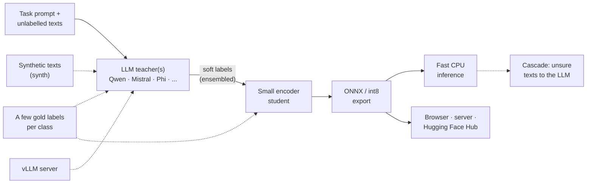

# tinydistill

**Most of a large model's quality on one task, many times faster, on a CPU.**

`tinydistill` turns an LLM classification prompt into a small encoder classifier by knowledge distillation.
You describe the task in a short YAML file (labels, how to say each label, an instruction prompt) and give it
unlabelled texts. An instruction-tuned LLM labels them with soft targets, a small encoder learns to imitate
those targets, and the result is exported to ONNX (optionally int8) for fast CPU inference.

It continues my bachelor's project on inference optimisation by distilling LLMs.



Each step is one command: `tinydistill label` (teacher), `train` (student), `export` (ONNX / int8) and
`predict` (inference), or `tinydistill run` for all of them. Dashed parts are optional: synthetic texts when
there is no unlabelled data, a vLLM server as the teacher, a few gold labels for the teacher's prompt and the
student's loss, and a cascade that hands the student's least confident texts to the LLM. The exported model
runs on a CPU, in a [browser](#deploying-cascade-server-browser), behind `tinydistill serve`, or from the
Hugging Face Hub.

## Results

Two tasks with `Qwen/Qwen2.5-1.5B-Instruct` as the zero-shot teacher, and Banking77 also with
`Qwen/Qwen2.5-7B-Instruct`; the student is always `sentence-transformers/all-MiniLM-L6-v2`. Quality is measured on gold-labelled test texts that
neither model trains on. Every table is written by the task's `run.sh` from its saved `results*.json` file in
[`examples/`](https://github.com/Andreas-Hum/tinydistill/tree/main/examples); no number is typed by hand. The teacher's latency includes scoring every surface form
of every label, which costs most on Banking77 with its many labels, so there the GPU teacher row is the fairer
reference for speed.

The tables below come from version 0.2.0 runs (zero-shot teachers, all surface forms, one training seed). The
0.3.0 demo scripts add few-shot teachers, gold-only baselines, several seeds, a student-size comparison and the
cascade; their results will replace these tables.

### Banking77: the hard case

Intent detection with 77 fine-grained classes ([Banking77](https://huggingface.co/datasets/PolyAI/banking77),
CC BY 4.0), reproduced by [`examples/banking77/run.sh`](https://github.com/Andreas-Hum/tinydistill/blob/main/examples/banking77/run.sh).

Teacher only, no gold labels:


<!-- results: banking77/results.md -->
| Model | Device | Accuracy | Macro-F1 | Agreement with teacher | Latency, batch 1 (ms) | Latency, batch 32 (ms) | Throughput (texts/s) | Size (MB) | Speed-up, batch 1 |
|---|---|---|---|---|---|---|---|---|---|
| teacher, zero-shot | cpu | 0.406 | 0.367 | n/a | 19955.9 | n/a | 0.1 | 6175 | 1.0x |
| teacher, zero-shot | cuda | 0.406 | 0.367 | n/a | 60.3 | n/a | 16.6 | 3087 | 331.1x |
| student, PyTorch | cpu | 0.386 | 0.315 | 0.772 | 3.9 | 78.3 | 408.9 | 91 | 5124.6x |
| student, ONNX fp32 | cpu | 0.386 | 0.315 | 0.772 | 2.6 | 82.4 | 388.4 | 91 | 7606.9x |
| student, ONNX int8 | cpu | 0.383 | 0.311 | 0.761 | 1.0 | 34.4 | 931.1 | 23 | 20502.9x |

Task `banking77`, 3080 gold-labelled test texts. Teacher: `Qwen/Qwen2.5-1.5B-Instruct`. Student: `sentence-transformers/all-MiniLM-L6-v2`. The student learns only from the teacher's soft labels on 10003 unlabelled training texts.
CPU rows use 2 threads. Latency is the median over repeated runs. Size is the teacher's weights as loaded and the students' model files. The teacher scores one text at a time, so it is timed at batch 1 and its throughput is 1 / latency. Speed-up is relative to the teacher, zero-shot on cpu.
<!-- /results -->

With 8 gold labels per class, and the student trained on all gold labels as an upper bound:

<!-- results: banking77/results-k8.md -->
| Model | Device | Accuracy | Macro-F1 | Agreement with teacher | Latency, batch 1 (ms) | Latency, batch 32 (ms) | Throughput (texts/s) | Size (MB) | Speed-up, batch 1 |
|---|---|---|---|---|---|---|---|---|---|
| teacher, zero-shot | cpu | 0.406 | 0.367 | n/a | 19699.4 | n/a | 0.1 | 6175 | 1.0x |
| teacher, zero-shot | cuda | 0.406 | 0.367 | n/a | 58.3 | n/a | 17.2 | 3087 | 338.1x |
| student, PyTorch | cpu | 0.404 | 0.324 | 0.699 | 3.9 | 76.7 | 417.4 | 91 | 5056.3x |
| upper bound: student on all gold labels | cpu | 0.911 | 0.909 | 0.412 | n/a | n/a | n/a | n/a | n/a |
| student, ONNX fp32 | cpu | 0.404 | 0.324 | 0.699 | 2.7 | 72.1 | 443.6 | 91 | 7306.9x |
| student, ONNX int8 | cpu | 0.398 | 0.318 | 0.697 | 1.0 | 36.7 | 872.1 | 23 | 18792.2x |

Task `banking77`, 3080 gold-labelled test texts. Teacher: `Qwen/Qwen2.5-1.5B-Instruct`. Student: `sentence-transformers/all-MiniLM-L6-v2`. The student learns from the teacher's soft labels on all 10003 training texts, plus cross-entropy on 8 gold labels per class (616 texts, weight 1.0). The upper bound is the same student trained with cross-entropy on all 10003 gold training labels and no teacher; its speed equals the student's.
CPU rows use 2 threads. Latency is the median over repeated runs. Size is the teacher's weights as loaded and the students' model files. The teacher scores one text at a time, so it is timed at batch 1 and its throughput is 1 / latency. Speed-up is relative to the teacher, zero-shot on cpu.
<!-- /results -->

With a stronger teacher, `Qwen/Qwen2.5-7B-Instruct` loaded in 4 bit (timed on the GPU only: 4-bit loading needs
CUDA), teacher only:

<!-- results: banking77/results-7b.md -->
| Model | Device | Accuracy | Macro-F1 | Agreement with teacher | Latency, batch 1 (ms) | Latency, batch 32 (ms) | Throughput (texts/s) | Size (MB) | Speed-up, batch 1 |
|---|---|---|---|---|---|---|---|---|---|
| teacher, zero-shot, 4-bit | cuda | 0.630 | 0.607 | n/a | 272.2 | n/a | 3.7 | 5443 | 1.0x |
| student, PyTorch | cpu | 0.623 | 0.587 | 0.827 | 5.5 | 93.0 | 344.2 | 91 | 49.4x |
| student, ONNX fp32 | cpu | 0.623 | 0.587 | 0.827 | 3.4 | 86.8 | 368.7 | 91 | 80.8x |
| student, ONNX int8 | cpu | 0.622 | 0.586 | 0.822 | 1.6 | 43.8 | 730.0 | 23 | 171.2x |

Task `banking77`, 3080 gold-labelled test texts. Teacher: `Qwen/Qwen2.5-7B-Instruct`. Student: `sentence-transformers/all-MiniLM-L6-v2`. The student learns only from the teacher's soft labels on 10003 unlabelled training texts.
CPU rows use 2 threads. Latency is the median over repeated runs. Size is the teacher's weights as loaded and the students' model files. The teacher scores one text at a time, so it is timed at batch 1 and its throughput is 1 / latency. Speed-up is relative to the teacher, zero-shot, 4-bit on cuda.
<!-- /results -->

The same teacher with 8 gold labels per class and the upper bound:

<!-- results: banking77/results-k8-7b.md -->
| Model | Device | Accuracy | Macro-F1 | Agreement with teacher | Latency, batch 1 (ms) | Latency, batch 32 (ms) | Throughput (texts/s) | Size (MB) | Speed-up, batch 1 |
|---|---|---|---|---|---|---|---|---|---|
| teacher, zero-shot, 4-bit | cuda | 0.630 | 0.607 | n/a | 295.4 | n/a | 3.4 | 5443 | 1.0x |
| student, PyTorch | cpu | 0.627 | 0.583 | 0.765 | 4.5 | 93.6 | 341.9 | 91 | 65.5x |
| upper bound: student on all gold labels | cpu | 0.911 | 0.909 | 0.631 | n/a | n/a | n/a | n/a | n/a |
| student, ONNX fp32 | cpu | 0.627 | 0.583 | 0.765 | 3.2 | 80.9 | 395.7 | 91 | 92.5x |
| student, ONNX int8 | cpu | 0.622 | 0.576 | 0.762 | 1.1 | 40.7 | 786.4 | 23 | 262.6x |

Task `banking77`, 3080 gold-labelled test texts. Teacher: `Qwen/Qwen2.5-7B-Instruct`. Student: `sentence-transformers/all-MiniLM-L6-v2`. The student learns from the teacher's soft labels on all 10003 training texts, plus cross-entropy on 8 gold labels per class (616 texts, weight 1.0). The upper bound is the same student trained with cross-entropy on all 10003 gold training labels and no teacher; its speed equals the student's.
CPU rows use 2 threads. Latency is the median over repeated runs. Size is the teacher's weights as loaded and the students' model files. The teacher scores one text at a time, so it is timed at batch 1 and its throughput is 1 / latency. Speed-up is relative to the teacher, zero-shot, 4-bit on cuda.
<!-- /results -->

### Financial tweets: an easier task

Sentiment of financial news tweets, 3 classes
([Twitter Financial News Sentiment](https://huggingface.co/datasets/zeroshot/twitter-financial-news-sentiment),
MIT licence per the dataset card), reproduced by
[`examples/financial-tweets/run.sh`](https://github.com/Andreas-Hum/tinydistill/blob/main/examples/financial-tweets/run.sh). The validation split is the test set.

<!-- results: financial-tweets/results.md -->
| Model | Device | Accuracy | Macro-F1 | Agreement with teacher | Latency, batch 1 (ms) | Latency, batch 32 (ms) | Throughput (texts/s) | Size (MB) | Speed-up, batch 1 |
|---|---|---|---|---|---|---|---|---|---|
| teacher, zero-shot | cpu | 0.535 | 0.557 | n/a | 976.3 | n/a | 1.0 | 6175 | 1.0x |
| teacher, zero-shot | cuda | 0.535 | 0.557 | n/a | 33.7 | n/a | 29.6 | 3087 | 28.9x |
| student, PyTorch | cpu | 0.517 | 0.542 | 0.815 | 4.5 | 145.4 | 220.1 | 91 | 219.3x |
| upper bound: student on all gold labels | cpu | 0.867 | 0.824 | 0.531 | n/a | n/a | n/a | n/a | n/a |
| student, ONNX fp32 | cpu | 0.517 | 0.542 | 0.815 | 3.2 | 148.5 | 215.4 | 91 | 303.9x |
| student, ONNX int8 | cpu | 0.513 | 0.538 | 0.810 | 1.3 | 71.5 | 447.7 | 23 | 754.7x |

Task `financial-tweets`, 2388 gold-labelled test texts. Teacher: `Qwen/Qwen2.5-1.5B-Instruct`. Student: `sentence-transformers/all-MiniLM-L6-v2`. The student learns only from the teacher's soft labels on 9543 unlabelled training texts. The upper bound is the same student trained with cross-entropy on all 9543 gold training labels and no teacher; its speed equals the student's.
CPU rows use 2 threads. Latency is the median over repeated runs. Size is the teacher's weights as loaded and the students' model files. The teacher scores one text at a time, so it is timed at batch 1 and its throughput is 1 / latency. Speed-up is relative to the teacher, zero-shot on cpu.
<!-- /results -->

## Quickstart

```sh
pip install "tinydistill[hf]"
curl -LO https://raw.githubusercontent.com/Andreas-Hum/tinydistill/main/examples/banking77/task.yaml
tinydistill run task.yaml --data hf:PolyAI/banking77:train --test hf:PolyAI/banking77:test \
  --out runs/banking77 --int8
tinydistill predict runs/banking77/onnx "I still haven't received my new card"
```

Labelling the full dataset with the default teacher wants a GPU. For a quick look on a CPU, add
`--teacher Qwen/Qwen2.5-0.5B-Instruct --limit 200 --test-limit 200`. `--limit` takes the first rows, and the
Banking77 splits are sorted by intent, so a limited run only sees a few intents.

`run` does every step. Each step also has its own command, and they all read and write the run directory:

| Command | What it does |
|---|---|
| `tinydistill init DATA [--out task.yaml]` | writes a starter task file from a dataset's label names |
| `tinydistill label TASK.yaml --data D [--test T] --out RUN` | teacher scores every label of every text; cached, resumable |
| `tinydistill train RUN` | distils the student from the teacher's soft targets |
| `tinydistill export RUN [--int8]` | writes `RUN/onnx` (ONNX, tokenizer, labels) |
| `tinydistill eval RUN` | writes `RUN/results.md` and `RUN/results.json` |
| `tinydistill predict RUN/onnx TEXT... [--data FILE]` | classifies texts, prints JSON lines |
| `tinydistill compare RUN...` | one table comparing runs, e.g. teachers or student sizes |
| `tinydistill serve RUN/onnx [--cascade RUN]` | a JSON HTTP endpoint (`POST /predict`) |
| `tinydistill web RUN/onnx --out site` | a static page that runs the model in the browser |
| `tinydistill push RUN/onnx --repo user/name` | uploads the model to the Hugging Face Hub with a model card |
| `tinydistill synth TASK.yaml --per-label N --out texts.jsonl` | has the teacher write unlabelled example texts |
| `tinydistill status RUN` | how far a running step is, and whether it is still running |
| `tinydistill tune TASK.yaml --data D --teacher a,b --few-shot 0,8` | compares teacher setups on a dev split |
| `tinydistill analyse RUN` | an error-analysis page: weakest labels, common confusions |
| `tinydistill suggest RUN --n 200 --out to_label.jsonl` | the texts most worth labelling by hand next |
| `tinydistill refresh RUN --log cascade.jsonl --out RUN2` | retrains with the texts the cascade sent to the teacher |
| `tinydistill report RUN` | rebuilds `results.md` from `results.json` |

Data can be `.csv`, `.jsonl` or `hf:<dataset>[:<config>]:<split>` (needs the `hf` extra). Useful options:
`--teacher` (any Hugging Face causal LM), `--load-4bit` (bitsandbytes, CUDA only: `pip install "tinydistill[4bit]"`),
`--student` (any Hugging Face encoder), `--epochs`, `--lr`, `--device`, `--threads`, `--seed`, and `--cache-dir`
(runs that share it label each text only once). See `tinydistill <command> --help`.

Long steps print their progress, speed and time left every few seconds and write it to `RUN/status.json`;
`tinydistill status RUN` reads it from another terminal and tells you whether the process is still alive.

**Static student.** `--student static` (or `static:<encoder>`) trains a student with no attention at all: one
vector per token, averaged, then a linear layer, started from the encoder's own token representations (as in
Model2Vec). It is much smaller and faster than a transformer student and usually less accurate; it exports to
ONNX and runs with `predict` and `serve` like any other student. Use a higher learning rate, such as
`--lr 1e-3`.

### Choosing the teacher

`--teacher` takes any Hugging Face causal LM with a chat template; the tests check the scoring against a
plain forward pass for Llama, Mistral, Phi, Gemma 2 and GPT-2 style models as well as Qwen. Several teachers,
comma-separated, are an **ensemble**: each scores every text (one model in memory at a time) and the soft
labels are the mean of their label probabilities. `tinydistill compare` then puts the runs side by side.

A **vLLM server** can be the teacher instead of a local model, so a large model on a GPU cluster does the
labelling: start it with `vllm serve MODEL --enable-prefix-caching` and pass `--vllm-url http://host:8000/v1`
with `--teacher MODEL`. Only the tokenizer is loaded locally; every continuation is scored exactly from the
server's prompt log-probabilities, so the soft labels are the same as with the local model.

**Many labels.** With hundreds or thousands of labels, scoring every one for every text gets slow.
`label --shortlist K` first compares each text with the label names (and descriptions) using a small
sentence-embedding model (`--shortlist-model`, MiniLM by default) and has the teacher score only the K most
similar labels; the others get probability zero. `eval` reports the **shortlist recall**: how often the gold
label was among the K. If it is low, raise K.

**Tuning the setup.** `tinydistill tune TASK.yaml --data D --teacher a,b --few-shot 0,8 --prompt other.yaml`
scores every combination of teacher, number of few-shot examples and prompt on a dev split of gold-labelled
*training* texts (`--dev-size`, default 200; never the test set) and writes `tune.md` and `tune.json` (`--out`), best first, with
the `label` command for the winner.

### No unlabelled data?

`tinydistill synth TASK.yaml --per-label 200 --out texts.jsonl` asks the teacher to write example inputs for
each label, from the task's own instruction. This is the only place where the teacher generates text, and only
inputs: the file has no label field, and the texts are labelled by the usual scoring when you pass them as
`--data`. Generated texts are less varied than real ones; use real texts when you have them.

### Deploying: cascade, server, browser

**Cascade.** `eval` adds a table of what happens when the student answers and passes the texts it is least
sure about to the teacher: accuracy and mean latency for 0 % to 100 % of the texts sent on. At inference,
`tinydistill predict RUN/onnx --cascade RUN --threshold T` (and `serve --cascade`) does this for real: texts
whose top student probability is below T go to the run's teacher. Choose T on a validation split.

**Server.** `tinydistill serve RUN/onnx` answers `POST /predict` with `{"texts": [...]}` and `GET /health`,
using only the standard library. It listens on 127.0.0.1 unless you pass `--host`.

**Browser.** `tinydistill web RUN/onnx --out site` writes a static page plus the model in the layout
[transformers.js](https://github.com/huggingface/transformers.js) expects; the int8 model then runs in the
visitor's browser with no server at all. Serve the folder with any static host (GitHub Pages works).

### A few gold labels

If some training texts have gold labels, they can help in three places. All of them use the same K randomly
chosen examples per class (fixed by `--seed`):

- `label --few-shot K` shows the examples in the teacher's prompt, in place of an `{examples}` line in the task's
  prompt. The prompt prefix is computed once, so even hundreds of examples cost little per text.
- `train --gold-per-class K` adds a cross-entropy term on their gold labels (weight `--ce-weight`, default 1) to
  the distillation loss.
- `train --gold-only` also trains the student on those labels alone, without the teacher, as a baseline row:
  what the teacher adds over the few labels.

`train --upper-bound` trains the same student on all gold training labels, again without the teacher: how far
distillation is from full supervision. `train --seeds N` repeats every student with N training seeds, and the
results show the mean and standard deviation.

### Improving a run

- `tinydistill analyse RUN` writes `RUN/analysis.html`: precision, recall and F1 of every label for the teacher
  and the student, the most common confusions with example texts, and texts where the two disagree. Labels
  the teacher gets wrong usually need a clearer name, a description, or merging.
- `tinydistill suggest RUN --n 200 --out to_label.jsonl` picks the training texts most worth labelling by hand:
  where the student and the teacher disagree, then where the teacher is least sure, spread over labels. Fill
  in the empty label field and pass the file back with `train RUN --gold-file to_label.jsonl`; those labels
  join the cross-entropy term.
- `predict --cascade RUN --log cascade.jsonl` (and `serve --cascade ... --log`) records every text the cascade
  passed to the teacher, with the teacher's scores. `tinydistill refresh RUN --log cascade.jsonl --out RUN2`
  adds them to the training texts and trains, exports and evaluates a new student on the same test set, so
  the student learns the inputs it found hard in production.

### From Python

The exported model:

```python
from tinydistill import Predictor

clf = Predictor("runs/banking77/onnx")  # uses model.int8.onnx when present
clf.predict(["How do I top up my card?"])  # list of label names
clf.predict_proba(["How do I top up my card?"])  # numpy array, one row per text
```

The whole pipeline, without the command line:

```python
from pathlib import Path

import torch
from tinydistill import Predictor, export_onnx, load_task, load_teacher, read_examples, train_student

task = load_task("task.yaml")
texts = [e.text for e in read_examples("hf:PolyAI/banking77:train", task, limit=1000)]
teacher = load_teacher("Qwen/Qwen2.5-1.5B-Instruct", task, device="cuda")
soft_targets = torch.tensor(teacher.score_many(texts)).softmax(-1)  # one row of label scores per text
train_student(texts, soft_targets, task.labels, Path("student"))
export_onnx(Path("student"), Path("student-onnx"), int8=True)
Predictor("student-onnx").predict(["Where is my card?"])
```

### The task file

```yaml
name: banking77
text_field: text        # column holding the input text
label_field: label      # column holding gold labels (ids, or integers indexing `labels`)
prompt: |-
  You are classifying messages that customers sent to their bank's support chat.
  Choose the single intent from this list that best matches the message:
  {labels}
  {examples}

  Message: {text}

  Reply with the intent exactly as written in the list.
surface_forms: [lowercase, capitalised]   # optional, see below
labels:
  - activate_my_card    # a bare id: its name is derived, "activate my card"
  - card_arrival
  # ...
```

For **multi-label** tasks, where a text can have any number of labels, add `multi_label: true` and ask about
one label at a time, with `{label}` after `{text}`:

```yaml
multi_label: true
prompt: |
  Review: {text}
  Does the review talk about {label}? Answer yes or no.
labels: [price, delivery, product_quality]
```

The teacher answers every label's question in the same forward pass, and a label's score is
log P(yes) − log P(no) over the surface forms of both answers (`answers: [yes, no]` changes them). The student
gets a multi-label head trained against the teacher's per-label probabilities, and the results show exact-match
accuracy, macro-F1 and micro-F1, with 0.5 as the cut-off. Gold labels can be lists or strings like `a|b`.
Few-shot examples and the cascade are for single-label tasks.

For labels with an order, such as 1 to 5 stars, add `ordinal: true`: the results then also show the mean
absolute error in label steps and the share of predictions at most one step off.

`{labels}` (required) becomes a bulleted list of the label names, `{text}` is the input, and an optional
`{examples}` line holds few-shot examples (it disappears when there are none). The name is what the teacher
scores. Each label can be a bare id as above, `id: name`, or carry a description that is shown in
the list (`- bullish: positive for the stock`) but not scored:

```yaml
labels:
  bearish:
    description: negative for the stock, company or market
  lost_card: lost or stolen card
```

## How the label scoring works

The teacher never generates free text. For an input x, the prompt is rendered with the model's chat template
(user message = the instruction with the label list, generation prompt for the assistant). A continuation is one
way of writing a label followed by the end-of-turn token, `c_1 ... c_m`, with log-probability

    log p(c | prompt(x)) = sum_j log p(c_j | prompt(x), c_1 ... c_(j-1))

Multi-token labels are handled exactly, and the end-of-turn token keeps a label that is a prefix of another
(`card` versus `card arrival`) from winning by stopping early. Models do not always write a label the way it is
listed: Qwen2.5 tends to answer a sentiment question with "Bullish" even when the list says "bullish". So each
label is scored over its common surface forms, the name as written, lowercase, Capitalised and UPPERCASE, each
with and without a leading space (forms that tokenise identically count once):

    score(label) = log sum over forms c of p(c | prompt(x))

This is verbaliser coverage: it only counts more ways of writing the same answer, and there is no calibration or
prior correction. All forms share the prefix tree below, but with many labels they still add up; a task file can
list fewer (`surface_forms: [lowercase, capitalised]` drops UPPERCASE, which tokenises into many pieces, and
`surface_forms: []` scores the name as written only). A softmax over the label scores gives the soft targets. The prompt lists each label in its
primary form, the name as written. The scores are cached as JSON lines keyed by a hash of the text, in a file
named after a fingerprint of the teacher, prompt and continuations, so an interrupted run resumes and a changed
prompt never reuses old scores.

To keep this fast, the part of the prompt before the text is run once and its key/value cache is kept. Each
text then needs a single forward pass that covers the text and all labels together: the tokens of all continuations
(every surface form of every label) form a prefix tree, so continuations that start alike, such as
`card arrival` and `card linking`, share nodes, and a 4D attention mask lets each tree node attend only to the
prompt, the text and its own ancestors. There is no padding and no per-label copy of the cache. When a task has
few labels and short texts, several texts are packed into one forward pass the same way, each attending only to
the prompt and itself (`--teacher-tokens`, default 2048 tokens per pass). Tests check the scores against a plain
forward pass per continuation, and packed against unpacked scores.

The student minimises KL(teacher || student) over the training texts, plus `--ce-weight` times the
cross-entropy on the K gold labels per class chosen by `--gold-per-class`, if any (standard knowledge
distillation, Hinton et al., 2015).

## Limitations

- **The teacher caps the student.** The student learns to imitate the teacher, mistakes included. A small LLM
  choosing zero-shot among many fine-grained labels can be weak: Qwen2.5-0.5B-Instruct, for example, often
  confuses related Banking77 intents. A bigger teacher (try `--load-4bit` with a 7B model) or a better prompt
  usually helps more than anything on the student side.
- **Scores are sums, not averages.** Longer verbalisations get lower scores, so very uneven label lengths bias the
  teacher. Keep verbalisations short and of similar length.
- **Only case and spacing variants are counted.** Plurals, synonyms or rephrasings of a label are not; keep label
  names short and close to how the teacher would answer.
- **A too-small teacher can collapse.** Qwen2.5-0.5B-Instruct, for example, puts nearly every text into one or two
  labels on the financial-tweets task, whatever the scoring; use 1.5B or larger.
- **Few-shot examples can hurt.** K examples per class tell the teacher that the classes are equally common,
  and the last examples in the prompt pull it towards their labels. On a skewed task the few-shot teacher can
  be worse than the zero-shot one; compare both (`tinydistill compare`) before relying on it.
- **Prompt and label order matter.** Zero-shot LLMs are sensitive to wording and to the order of the options.
- **Teacher cost grows with labels.** Every text is scored against every surface form of every label (shared
  prefixes are computed once). With very many labels use `--shortlist K`; a gold label outside the shortlist
  cannot be learned from the teacher for that text.
- **Multi-label tasks ask one question per label**, so they cost one forward pass per label and text.
  Inputs are truncated to 128 tokens by default (`--max-length`).
- **Timings depend on the machine.** The results table states the threads and devices used; rerun `eval` on your
  own hardware.
- ONNX export uses PyTorch's TorchScript-based exporter.

## Development

```sh
python -m venv .venv && . .venv/bin/activate
pip install torch --index-url https://download.pytorch.org/whl/cpu
pip install -e ".[dev]"
ruff check . && ruff format --check . && pytest
```

The tests run on a CPU in a few seconds with tiny random models from `hf-internal-testing`. They check the label
scores against a direct computation, the distillation loss and metrics against hand-computed values, cache
resumption, that the ONNX export reproduces the PyTorch logits, and the whole CLI end to end.

See [CONTRIBUTING.md](CONTRIBUTING.md) for how to propose changes, [SECURITY.md](SECURITY.md) for reporting
vulnerabilities and [CODE_OF_CONDUCT.md](CODE_OF_CONDUCT.md) for the code of conduct.

## References

- G. Hinton, O. Vinyals, J. Dean. [Distilling the Knowledge in a Neural Network](https://arxiv.org/abs/1503.02531). arXiv:1503.02531, 2015.
- T. Schick, H. Schütze. [Exploiting Cloze Questions for Few Shot Text Classification and Natural Language Inference](https://arxiv.org/abs/2001.07676). EACL, 2021. (Verbalisers.)
- I. Casanueva, T. Temčinas, D. Gerz, M. Henderson, I. Vulić. [Efficient Intent Detection with Dual Sentence Encoders](https://arxiv.org/abs/2003.04807). NLP4ConvAI Workshop, 2020. (Banking77.)
- W. Wang, F. Wei, L. Dong, H. Bao, N. Yang, M. Zhou. [MiniLM: Deep Self-Attention Distillation for Task-Agnostic Compression of Pre-Trained Transformers](https://arxiv.org/abs/2002.10957). NeurIPS, 2020.
- N. Reimers, I. Gurevych. [Sentence-BERT: Sentence Embeddings using Siamese BERT-Networks](https://arxiv.org/abs/1908.10084). EMNLP, 2019.
- Qwen Team. [Qwen2.5 Technical Report](https://arxiv.org/abs/2412.15115). arXiv:2412.15115, 2024.

## Licence

[MIT](https://github.com/Andreas-Hum/tinydistill/blob/main/LICENSE). The Banking77 dataset is CC BY 4.0 (PolyAI); models are downloaded from the Hugging Face Hub under
their own licences.
