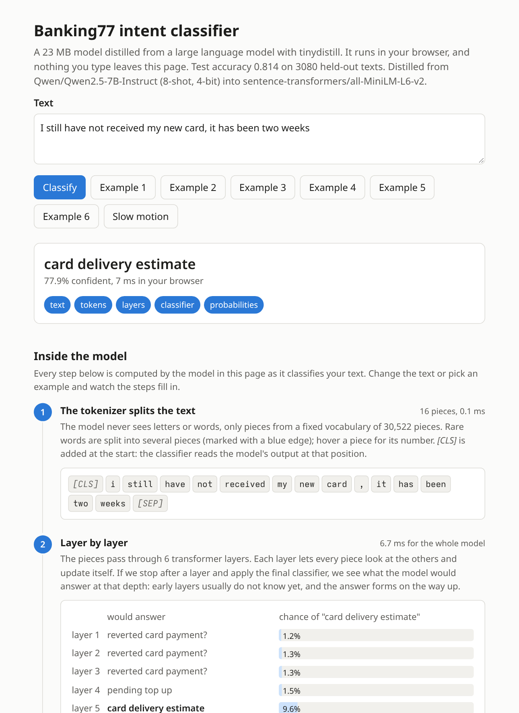
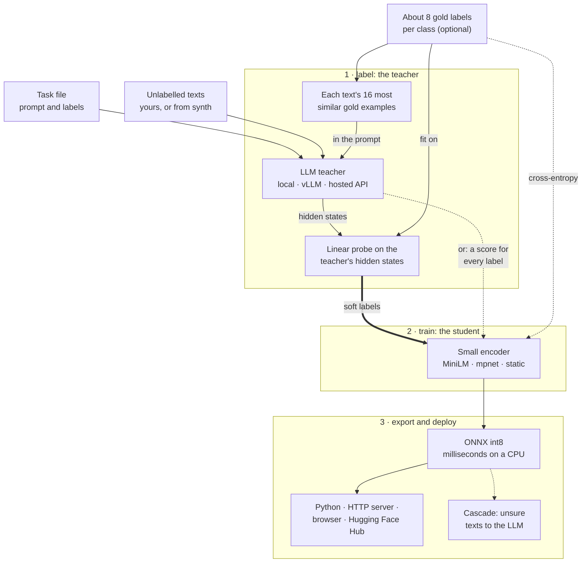
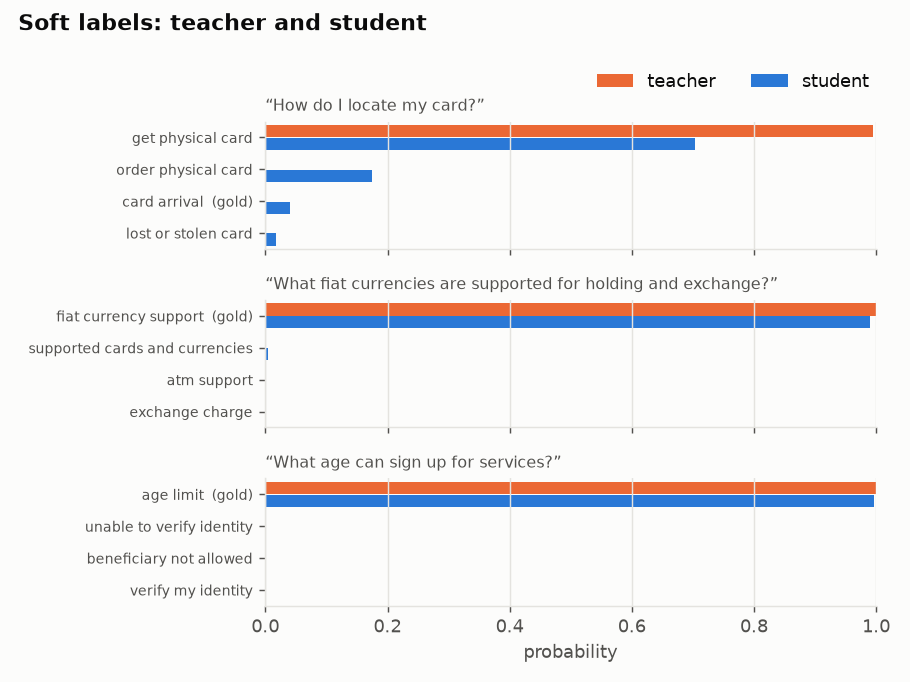
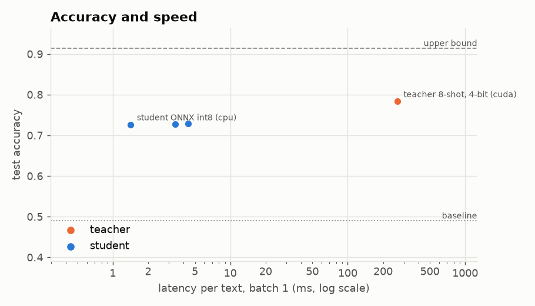

# tinydistill

<a href="https://pypi.org/project/tinydistill/"></a>
<a href="https://pypi.org/project/tinydistill/"></a>
<a href="https://github.com/Andreas-Hum/tinydistill/actions/workflows/ci.yml"></a>
<a href="https://pepy.tech/projects/tinydistill"></a>
<a href="https://github.com/Andreas-Hum/tinydistill/blob/main/LICENSE"></a>
<a href="https://colab.research.google.com/github/Andreas-Hum/tinydistill/blob/main/notebooks/quickstart.ipynb"></a>
<a href="https://andreas-hum.github.io/tinydistill/"></a>
<a href="https://andreas-hum.github.io/tinydistill/demo/"></a>
<a href="https://huggingface.co/collections/Shroomy/tinydistill-6aea5b24819dbca9cb7eeb8d"></a>

**Most of a large model's quality on one task, many times faster, on a CPU.**

`tinydistill` turns an LLM classification prompt into a small classifier by knowledge distillation. Describe
the task in a short YAML file and give it unlabelled texts: an instruction-tuned LLM labels them with soft
targets, a small encoder learns to imitate them, and the result is exported to ONNX (optionally int8) for fast
inference on a CPU, in a browser or behind an HTTP server. It continues my bachelor's project on inference
optimisation by distilling LLMs.

**[Documentation](https://andreas-hum.github.io/tinydistill/)** · [Live demo](https://andreas-hum.github.io/tinydistill/demo/) ·
[Distillation playground](https://andreas-hum.github.io/distillation-playground/) ·
[Benchmarks](https://github.com/Andreas-Hum/tinydistill/blob/main/RESULTS.md) ·
[Notebooks](https://andreas-hum.github.io/tinydistill/getting-started/notebooks/)

<p align="center">
  <a href="https://andreas-hum.github.io/tinydistill/demo/">
    <picture>
      <source media="(prefers-color-scheme: dark)" srcset="https://raw.githubusercontent.com/Andreas-Hum/tinydistill/main/docs/images/demo-dark.png">
      
    </picture>
  </a>
</p>
<p align="center"><i>The <a href="https://andreas-hum.github.io/tinydistill/demo/">live demo</a>: a 23 MB student distilled from Qwen2.5-7B runs in your
browser. <a href="https://andreas-hum.github.io/tinydistill/demo/?tour=1">Inside the model</a> shows every layer and
attention head as it reads your text, with a guided tour.</i></p>

## Highlights

- **No labels needed.** Any instruction-tuned LLM on the Hugging Face Hub labels your texts by scoring every
  label in one forward pass: no text generation, no answer parsing ([how](#how-the-label-scoring-works)).
- **Small, fast students.** A 23 MB MiniLM or an 8 MB static-embedding model, more accurate than its 7B teacher
  on Banking77 and over 150x faster on a CPU than the teacher on a GPU ([results](#results)).
- **Any teacher.** Local models in full precision or 4 bit, ensembles of several model families, or a remote
  [vLLM](https://github.com/vllm-project/vllm) server ([choosing the teacher](#choosing-the-teacher)).
- **Honest numbers.** Every run reports the accuracy, latency and size of teacher and student, with gold-only
  baselines, upper bounds and several seeds.
- **A few labels go a long way.** Gold examples can go into the teacher's prompt and the student's loss
  ([a few gold labels](#a-few-gold-labels)).
- **Tools around the loop.** Tune the setup on a dev split, see where it goes wrong, pick texts to label,
  route unsure texts to the LLM and retrain on them ([improving a run](#improving-a-run)).
- **Deploy anywhere.** ONNX and int8, `tinydistill serve`, a static web page, or the Hugging Face Hub and
  `Predictor("hf:user/name")` ([deploying](#deploying-cascade-server-browser)).

## Installation

```sh
pip install tinydistill               # label, train, export, predict
pip install "tinydistill[hf]"         # + Hugging Face datasets as input (hf:<dataset>:<split>)
pip install "tinydistill[hf,4bit]"    # + 4-bit teachers with bitsandbytes (CUDA)
pip install "tinydistill[plot]"       # + charts of a run (matplotlib)
```

Python 3.11 or newer, on Linux, macOS or Windows. Labelling with a large teacher wants a GPU; training and
inference are fine on a CPU. For a CPU-only PyTorch, install it first:
`pip install torch --index-url https://download.pytorch.org/whl/cpu`.

## Quickstart

To try a distilled model before training your own, the Banking77 student from the [results](#results) is on
the [Hugging Face Hub](https://huggingface.co/Shroomy/tinydistill-banking77-minilm) (it also runs in your
browser in a [Space](https://huggingface.co/spaces/Shroomy/tinydistill-banking77-demo)):

```python
from tinydistill import Predictor  # pip install tinydistill

clf = Predictor("hf:Shroomy/tinydistill-banking77-minilm")
clf.describe(["I still haven't received my new card", "My card got stolen"])
# [{'label': 'card_arrival', 'confidence': 0.4672}, {'label': 'lost_or_stolen_card', 'confidence': 0.9921}]
```

To distil your own:

```sh
curl -LO https://raw.githubusercontent.com/Andreas-Hum/tinydistill/main/examples/banking77/task.yaml
tinydistill run task.yaml --data hf:PolyAI/banking77:train --test hf:PolyAI/banking77:test \
  --out runs/banking77 --int8
tinydistill predict runs/banking77/onnx "I still haven't received my new card"
```

The same from Python, with the exported model:

```python
from tinydistill import Predictor

clf = Predictor("runs/banking77/onnx")  # or a model on the Hub: Predictor("hf:user/name")
clf.predict(["I still haven't received my new card"])  # a list of label names
```

Or try it without installing anything, on a free Colab GPU:

| Notebook | What it shows |
|---|---|
| [Quickstart](https://colab.research.google.com/github/Andreas-Hum/tinydistill/blob/main/notebooks/quickstart.ipynb) | distil a sentiment classifier in about ten minutes, with charts of what the student learned |
| [Your own task](https://colab.research.google.com/github/Andreas-Hum/tinydistill/blob/main/notebooks/your_task.ipynb) | write a task for your labels, check the teacher, distil on your texts, find the mistakes, download the model |
| [Deploy](https://colab.research.google.com/github/Andreas-Hum/tinydistill/blob/main/notebooks/deploy.ipynb) | the model from Python, behind an HTTP server, in a web page, and on the Hugging Face Hub |

Labelling the full dataset with the default teacher wants a GPU. For a quick look on a CPU, add
`--teacher Qwen/Qwen2.5-0.5B-Instruct --limit 200 --test-limit 200`. `--limit` takes the first rows, and the
Banking77 splits are sorted by intent, so a limited run only sees a few intents.

`run` does every step. Each step also has its own command, and they all read and write the run directory:

| Command | What it does |
|---|---|
| `tinydistill init DATA [--out task.yaml]` | writes a starter task file from a dataset's label names |
| `tinydistill label TASK.yaml --data D [--test T] --out RUN` | teacher scores every label of every text; cached, resumable |
| `tinydistill train RUN` | distils the student from the teacher's soft targets |
| `tinydistill export RUN [--int8]` | writes `RUN/onnx` (ONNX, tokenizer, labels) |
| `tinydistill eval RUN` | writes `RUN/results.md` and `RUN/results.json` |
| `tinydistill predict RUN/onnx TEXT... [--data FILE]` | classifies texts, prints JSON lines |
| `tinydistill compare RUN...` | one table comparing runs, e.g. teachers or student sizes |
| `tinydistill serve RUN/onnx [--cascade RUN]` | a JSON HTTP endpoint (`POST /predict`) |
| `tinydistill web RUN/onnx --out site` | a static page that runs the model in the browser |
| `tinydistill push RUN/onnx --repo user/name` | uploads the model to the Hugging Face Hub with a model card |
| `tinydistill synth TASK.yaml --per-label N --out texts.jsonl` | has the teacher write unlabelled example texts |
| `tinydistill status RUN` | how far a running step is, and whether it is still running (`--live`: a page in the browser that follows it; a directory of runs: a table of them all) |
| `tinydistill cache runs/cache` | what the score caches hold and which runs use them (`--prune`: delete the unused ones) |
| `tinydistill tune TASK.yaml --data D --teacher a,b --few-shot 0,8` | compares teacher setups on a dev split |
| `tinydistill analyse RUN` | an error-analysis page: weakest labels, common confusions |
| `tinydistill suggest RUN --n 200 --out to_label.jsonl` | the texts most worth labelling by hand next |
| `tinydistill refresh RUN --log cascade.jsonl --out RUN2` | retrains with the texts the cascade sent to the teacher |
| `tinydistill improve RUN --rounds 3 --per-round 200` | retrains with teacher-written texts for the student's confusions |
| `tinydistill report RUN` | rebuilds `results.md` from `results.json` |

Data can be `.csv`, `.jsonl` or `hf:<dataset>[:<config>]:<split>` (needs the `hf` extra). Useful options:
`--teacher` (any Hugging Face causal LM), `--load-4bit` (bitsandbytes, CUDA only: `pip install "tinydistill[4bit]"`),
`--student` (any Hugging Face encoder), `--epochs`, `--lr`, `--device`, `--threads`, `--seed`, and `--cache-dir`
(runs that share it label each text only once, and a run whose texts are all cached does not load the
teacher at all). See `tinydistill <command> --help`.

Long steps print their progress, speed and time left every few seconds and write it to `RUN/status.json`;
`tinydistill status RUN` reads it from another terminal and tells you whether the process is still alive.
With `--live` (also on `run`) it serves a page on `http://127.0.0.1` that follows the run: the stage and time
left, the stages done, the training loss per epoch and the results once they are written.

## Results

Banking77 intent detection: 77 fine-grained classes, 3,080 held-out test texts; the student is the one in the
[live demo](https://andreas-hum.github.io/tinydistill/demo/). The teacher's prompt shows each text the 16 most
similar of 616 gold examples (8 per class), its scores are averaged with a linear probe on its hidden states
fit on the same examples, and the student learns from its soft labels on 10,003 training texts plus those 616
gold labels. Latency is per text, one at a time:

<!-- results: headline.md -->
| Model | Runs on | Test accuracy | Latency per text | Size | Speed-up |
|---|---|---|---|---|---|
| Teacher: `Qwen/Qwen2.5-7B-Instruct`, 4-bit, 16 most similar examples in the prompt, plus a linear probe | RTX 4090 | 0.859 | 155 ms | 5.4 GB | 1x |
| Student: MiniLM-L6, int8 ONNX | CPU, 2 threads | 0.872 | 1.0 ms | 23 MB | 153x |
<!-- /results -->

- The student is **more accurate than its teacher**: learning its soft labels across 10,000 texts smooths out
  some of its individual mistakes.
- On a CPU it is **over 150 times faster** than the teacher on a GPU, at a fraction of its size. An 8 MB
  static-embedding student, distilled from the teacher with all 616 examples in its prompt, is faster still:
  0.1 ms per text at 0.802 accuracy.
- **The teacher sets the ceiling.** With a 1.5B teacher, or without examples in its prompt, the students are
  much weaker; the same student trained on all 10,003 gold labels reaches 0.914.
- **Many labels.** On CLINC150 (151 intents), `--shortlist 20 --shortlist-keep oos` labelled six times
  faster than scoring every label and was more accurate. With each text's 16 most similar gold examples in
  the prompt of Gemma 4 12B, averaged with a linear probe on its hidden states, the deployed student reaches
  0.859, against 0.574 zero-shot
  ([RESULTS.md](https://github.com/Andreas-Hum/tinydistill/blob/main/RESULTS.md#the-newer-teachers-with-similar-examples-and-both-together)).
- **Fast labelling, by default.** With gold labels the probe is the whole teacher (`--probe-only`, the default
  from 0.7.0): the teacher scores no labels, it only gives the probe its hidden states. On CLINC150 the deployed student reached 0.851 after 37 minutes of labelling instead of 0.859 after
  7.2 hours, and on Banking77 0.869 after 11.5 minutes instead of 0.872 after 35
  ([RESULTS.md](https://github.com/Andreas-Hum/tinydistill/blob/main/RESULTS.md#the-probe-alone-minutes-of-labelling-instead-of-hours)).
- **A new task.** On HWU64 (64 intents), which none of the settings were tuned on, the settings the docs
  recommend gave a deployed student of 0.888 after 16 minutes of labelling with `--probe-only`, against 0.639
  for the same student on its 512 gold labels alone
  ([RESULTS.md](https://github.com/Andreas-Hum/tinydistill/blob/main/RESULTS.md#hwu64-a-task-the-settings-were-not-tuned-on)).
- **Compared with SetFit**, a strong few-shot method that needs no LLM, on the same 616 gold labels: 0.813
  against 0.797 with the same encoder. Distillation needs a GPU for the teacher; SetFit trains in a minute
  ([comparison](https://github.com/Andreas-Hum/tinydistill/blob/main/RESULTS.md#compared-with-setfit)).

[RESULTS.md](https://github.com/Andreas-Hum/tinydistill/blob/main/RESULTS.md) has every run: four teachers, six student models trained for 5 to 20 epochs, the gold-only baseline,
the upper bound, the cascade and SetFit on Banking77, 151 labels with and without a shortlist on CLINC150,
task-file checks on AG News, a teacher ensemble and synthetic texts on financial tweets, multi-label
GoEmotions, and a vLLM check. Every number comes from a saved results file written by the
scripts in [`examples/`](https://github.com/Andreas-Hum/tinydistill/tree/main/examples).

## How it works



Each step is one command: `tinydistill label` (teacher), `train` (student), `export` (ONNX / int8) and
`predict` (inference), or `tinydistill run` for all of them. With gold labels and a local teacher, the teacher
sees each text's most similar gold examples, and a linear probe on its hidden states gives the soft labels,
so labelling takes minutes; without gold labels, or with `--probe`, the teacher scores every label. Dashed
parts are optional. Around this: `tune` checks the task file with the teacher before labelling, `synth` writes
texts when there is no unlabelled data, `train --out` trains another student on the same labels, `refresh`
retrains on the texts the cascade sent to the LLM, and `improve` has the teacher write texts for the student's
confusions. The exported model runs on a CPU, in a [browser](#deploying-cascade-server-browser), behind
`tinydistill serve`, from the Hugging Face Hub, or in a few lines of Python with `Distiller`.

## Guide

### Training the student

The student trains for `--epochs` passes over the training texts (default 10) on the KL divergence to the
teacher's soft labels, plus cross-entropy on any gold labels (`--gold-per-class`, `--gold-file`). On Banking77,
training longer mattered more than a bigger student: MiniLM-L6 reaches 0.729 after 5 epochs and 0.813 after 20
([RESULTS.md](https://github.com/Andreas-Hum/tinydistill/blob/main/RESULTS.md#banking77-the-hard-case)).

To choose the number of epochs from the data, `--val-share 0.05` holds out 5% of the training texts (texts
without gold labels, so no labels are lost), measures the loss on them after every epoch, keeps the best epoch
and stops after `--patience` epochs (default 3) without improvement. No gold labels are needed: the held-out
loss is measured against the teacher's soft labels. `--seeds N` trains every student N times and reports the
mean and standard deviation.

**Static student.** `--student static` (or `static:<encoder>`) trains a student with no attention at all: one
vector per token, averaged, then a linear layer, started from the encoder's own token representations (as in
Model2Vec). It is much smaller and faster than a transformer student. It ignores word order, so it can miss
meaning that depends on it (negation, "A rather than B"); on Banking77 it came within about a point of
MiniLM students trained as long (see the results). It exports to ONNX and runs with `predict` and `serve` like any other student, but
not in the browser page. Train it longer and at a higher learning rate, such as `--epochs 20 --lr 1e-3`.

### Choosing the teacher

`--teacher` takes any Hugging Face causal LM with a chat template; the tests check the scoring against a
plain forward pass for Llama, Mistral, Phi, Gemma 2 and GPT-2 style models as well as Qwen. Several teachers,
comma-separated, are an **ensemble**: each scores every text (one model in memory at a time) and the soft
labels are the mean of their label probabilities. `tinydistill compare` then puts the runs side by side.

A **vLLM server** can be the teacher instead of a local model, so a large model on a GPU cluster does the
labelling: start it with `vllm serve MODEL --enable-prefix-caching` and pass `--vllm-url http://host:8000/v1`
with `--teacher MODEL`. Only the tokenizer is loaded locally; every continuation is scored exactly from the
server's prompt log-probabilities, so the soft labels are the same as with the local model.

A **hosted API** (OpenAI, DeepInfra, Together, a llama.cpp server, ...) works too: `--api-url
https://api.openai.com/v1 --teacher MODEL`, with the key in `OPENAI_API_KEY` (or the variable named by
`--api-key-env`). Such APIs give only the top 20 log-probabilities of the first answer token, so the labels are
shown as options A, B, C, ... and scored by the answer letter: single-label tasks with at most 20 labels. The
texts are sent to the provider, so check their data policy.

**Many labels.** With hundreds or thousands of labels, scoring every one for every text gets slow.
`label --shortlist K` first compares each text with the label names (and descriptions) using a small
sentence-embedding model (`--shortlist-model`, MiniLM by default) and has the teacher score only the K most
similar labels; the others get probability zero. `eval` reports the **shortlist recall**: how often the gold
label was among the K. If it is low, raise K. A catch-all label such as "other" or "out of scope" resembles no
particular text, so it is rarely shortlisted: `--shortlist-keep oos` (comma-separated label ids) has the teacher
score it for every text as well.

**Tuning the setup.** `tinydistill tune TASK.yaml --data D --teacher a,b --few-shot 0,8 --prompt other.yaml`
scores every combination of teacher, number of few-shot examples and prompt on a dev split of gold-labelled
*training* texts (`--dev-size`, default 200; never the test set) and writes `tune.md` and `tune.json` (`--out`), best first, with
the `label` command for the winner.

### No unlabelled data?

`tinydistill synth TASK.yaml --per-label 200 --out texts.jsonl` asks the teacher to write example inputs for
each label, from the task's own instruction. This is the only place where the teacher generates text, and only
inputs: the file has no label field, and the texts are labelled by the usual scoring when you pass them as
`--data`. Generated texts are less varied than real ones; use real texts when you have them.

### Deploying: cascade, server, browser

**Cascade.** `eval` adds a table of what happens when the student answers and passes the texts it is least
sure about to the teacher: accuracy and mean latency for 0 % to 100 % of the texts sent on. At inference,
`tinydistill predict RUN/onnx --cascade RUN --threshold T` (and `serve --cascade`) does this for real: texts
whose top student probability is below T go to the run's teacher. Choose T on a validation split.

**Server.** `tinydistill serve RUN/onnx` answers `POST /predict` with `{"texts": [...]}` and `GET /health`,
using only the standard library. It listens on 127.0.0.1 unless you pass `--host`.

**Browser.** `tinydistill web RUN/onnx --out site` writes a static page plus the model in the layout
[transformers.js](https://github.com/huggingface/transformers.js) expects; the int8 model then runs in the
visitor's browser with no server at all. It sets the teacher against the student (from `results.json`), answers
as you type, and checks itself on up to 200 bundled test texts. "How does it work?" shows each step of the
inference (tokens, the answer after each layer, attention, probabilities, which words matter, the teacher's soft
labels and the cascade), with the formulas on request, so the page also explains distillation. Serve the folder
with any static host (GitHub Pages works).

**Hugging Face Hub.** `tinydistill push RUN/onnx --repo user/name` uploads the model with a model card.
Anyone can then use it without the run directory: `Predictor("hf:user/name")` in Python, or
`tinydistill predict hf:user/name "some text"`, `serve hf:user/name` and `web hf:user/name --out site` on the
command line. These models from the results are published that way, in a
[collection](https://huggingface.co/collections/Shroomy/tinydistill-6aea5b24819dbca9cb7eeb8d):

| Model | Task | Size | Test accuracy |
|---|---|---|---|
| [`Shroomy/tinydistill-banking77-minilm`](https://huggingface.co/Shroomy/tinydistill-banking77-minilm) | Banking77, 77 intents | 23 MB | 0.872 |
| [`Shroomy/tinydistill-banking77-static`](https://huggingface.co/Shroomy/tinydistill-banking77-static) | Banking77, static embeddings | 8 MB | 0.802 |
| [`Shroomy/tinydistill-financial-tweets-minilm`](https://huggingface.co/Shroomy/tinydistill-financial-tweets-minilm) | financial tweet sentiment | 23 MB | 0.820 |

### A few gold labels

If some training texts have gold labels, they can help in three places. All of them use the same K randomly
chosen examples per class (fixed by `--seed`):

- `label --few-shot K` shows the examples in the teacher's prompt, in place of an `{examples}` line in the task's
  prompt. The prompt prefix is computed once, so even hundreds of examples cost little per text.
- `train --gold-per-class K` adds a cross-entropy term on their gold labels (weight `--ce-weight`, default 1) to
  the distillation loss.
- `train --gold-only` also trains the student on those labels alone, without the teacher, as a baseline row:
  what the teacher adds over the few labels.

`train --upper-bound` trains the same student on all gold training labels, again without the teacher: how far
distillation is from full supervision. `train --seeds N` repeats every student with N training seeds, and the
results show the mean and standard deviation.

### Improving a run

- `tinydistill analyse RUN` writes `RUN/analysis.html`: precision, recall and F1 of every label for the teacher
  and the student, the most common confusions with example texts, and texts where the two disagree. Labels
  the teacher gets wrong usually need a clearer name, a description, or merging.
- `tinydistill suggest RUN --n 200 --out to_label.jsonl` picks the training texts most worth labelling by hand:
  where the student and the teacher disagree, then where the teacher is least sure, spread over labels. Fill
  in the empty label field and pass the file back with `train RUN --gold-file to_label.jsonl`; those labels
  join the cross-entropy term.
- `predict --cascade RUN --log cascade.jsonl` (and `serve --cascade ... --log`) records every text the cascade
  passed to the teacher, with the teacher's scores. `tinydistill refresh RUN --log cascade.jsonl --out RUN2`
  adds them to the training texts and trains, exports and evaluates a new student on the same test set, so
  the student learns the inputs it found hard in production.

### Charts and metrics

`tinydistill plot RUN` (with the `plot` extra) writes the charts of a run to `RUN/plots/`; in Python every
chart is a function in `tinydistill.plots` that returns a matplotlib figure, so it shows inline in a notebook:

| Chart | What it shows |
|---|---|
| `soft_labels` | for a few test texts, the teacher's probabilities (the soft labels) next to the student's |
| `speed_accuracy` | accuracy against latency for the teacher and every form of the student, with the baseline and upper bound |
| `training` | the loss per epoch on the training texts and, with `--val-share`, on the held-out texts and the kept epoch |
| `per_label` | F1 of every label for teacher and student, the teacher's weakest first |
| `confusions` | the confusion matrix over the labels involved in the most mistakes |
| `cascade` | accuracy as the student passes more of its least confident texts to the teacher |

<p align="center">
  
  
</p>

Every run's results report accuracy and macro-F1, agreement with the teacher, latency at batch 1 and 32,
throughput and size; tasks with more than five labels also get top-3 accuracy, multi-label tasks micro-F1, and
ordered labels the mean distance in label steps. `tinydistill analyse RUN` adds a page of per-label scores and
example mistakes.

### From Python

The exported model:

```python
from tinydistill import Predictor

clf = Predictor("runs/banking77/onnx")  # uses model.int8.onnx when present
clf.predict(["How do I top up my card?"])  # list of label names
clf.predict_proba(["How do I top up my card?"])  # numpy array, one row per text
```

The whole pipeline in a few lines, scikit-learn style (`fit` labels the texts with the teacher, trains the
student and exports it):

```python
from tinydistill import Distiller

clf = Distiller("task.yaml", teacher="Qwen/Qwen2.5-1.5B-Instruct", cache_dir="cache")
clf.fit(texts)  # a list of training texts; fit(texts, gold) also takes gold labels (None for none)
clf.predict(["Where is my card?"])  # one label id per text
clf.save("model")  # a folder Predictor reads; Distiller.load("model") gives it back
```

Step by step, without the command line:

```python
from pathlib import Path

import torch
from tinydistill import Predictor, export_onnx, load_task, load_teacher, read_examples, train_student

task = load_task("task.yaml")
texts = [e.text for e in read_examples("hf:PolyAI/banking77:train", task, limit=1000)]
teacher = load_teacher("Qwen/Qwen2.5-1.5B-Instruct", task, device="cuda")
soft_targets = torch.tensor(teacher.score_many(texts)).softmax(-1)  # one row of label scores per text
train_student(texts, soft_targets, task.labels, Path("student"))
export_onnx(Path("student"), Path("student-onnx"), int8=True)
Predictor("student-onnx").predict(["Where is my card?"])
```

### The task file

```yaml
name: banking77
text_field: text        # column holding the input text
label_field: label      # column holding gold labels (ids, or integers indexing `labels`)
prompt: |-
  You are classifying messages that customers sent to their bank's support chat.
  Choose the single intent from this list that best matches the message:
  {labels}
  {examples}

  Message: {text}

  Reply with the intent exactly as written in the list.
surface_forms: [lowercase, capitalised]   # optional, see below
labels:
  - activate_my_card    # a bare id: its name is derived, "activate my card"
  - card_arrival
  # ...
```

For **multi-label** tasks, where a text can have any number of labels, add `multi_label: true` and ask about
one label at a time, with `{label}` after `{text}`:

```yaml
multi_label: true
prompt: |
  Review: {text}
  Does the review talk about {label}? Answer yes or no.
labels: [price, delivery, product_quality]
```

The teacher answers every label's question in the same forward pass, and a label's score is
log P(yes) − log P(no) over the surface forms of both answers (`answers: [yes, no]` changes them). The student
gets a multi-label head trained against the teacher's per-label probabilities, and the results show exact-match
accuracy, macro-F1 and micro-F1, with 0.5 as the cut-off. Gold labels can be lists or strings like `a|b`.
A multi-label student has a yes/no decision per label to learn and needs more epochs: on GoEmotions, 10 were
too few and `--epochs 30 --val-share 0.05` brought it close to its teacher.
Few-shot examples and the cascade are for single-label tasks.

For labels with an order, such as 1 to 5 stars, add `ordinal: true`: the results then also show the mean
absolute error in label steps and the share of predictions at most one step off.

`{labels}` (required) becomes a bulleted list of the label names, `{text}` is the input, and an optional
`{examples}` line holds few-shot examples (it disappears when there are none). The name is what the teacher
scores. Each label can be a bare id as above, `id: name`, or carry a description that is shown in
the list (`- bullish: positive for the stock`) but not scored:

```yaml
labels:
  bearish:
    description: negative for the stock, company or market
  lost_card: lost or stolen card
```

## How the label scoring works

The teacher never generates free text. For an input x, the prompt is rendered with the model's chat template
(user message = the instruction with the label list, generation prompt for the assistant). A continuation is one
way of writing a label followed by the end-of-turn token, `c_1 ... c_m`, with log-probability

    log p(c | prompt(x)) = sum_j log p(c_j | prompt(x), c_1 ... c_(j-1))

Multi-token labels are handled exactly, and the end-of-turn token keeps a label that is a prefix of another
(`card` versus `card arrival`) from winning by stopping early. Models do not always write a label the way it is
listed: Qwen2.5 tends to answer a sentiment question with "Bullish" even when the list says "bullish". So each
label is scored over its common surface forms, the name as written, lowercase, Capitalised and UPPERCASE, each
with and without a leading space (forms that tokenise identically count once):

    score(label) = log sum over forms c of p(c | prompt(x))

This is verbaliser coverage: it only counts more ways of writing the same answer, and there is no calibration or
prior correction. All forms share the prefix tree below, but with many labels they still add up; a task file can
list fewer (`surface_forms: [lowercase, capitalised]` drops UPPERCASE, which tokenises into many pieces, and
`surface_forms: []` scores the name as written only). A softmax over the label scores gives the soft targets. The prompt lists each label in its
primary form, the name as written. The scores are cached as JSON lines keyed by a hash of the text, in a file
named after a fingerprint of the teacher, prompt and continuations, so an interrupted run resumes and a changed
prompt never reuses old scores.

To keep this fast, the part of the prompt before the text is run once and its key/value cache is kept. Each
text then needs a single forward pass that covers the text and all labels together: the tokens of all continuations
(every surface form of every label) form a prefix tree, so continuations that start alike, such as
`card arrival` and `card linking`, share nodes, and a 4D attention mask lets each tree node attend only to the
prompt, the text and its own ancestors. There is no padding and no per-label copy of the cache. When a task has
few labels and short texts, several texts are packed into one forward pass the same way, each attending only to
the prompt and itself (`--teacher-tokens`, default 2048 tokens per pass). Tests check the scores against a plain
forward pass per continuation, and packed against unpacked scores.

The student minimises KL(teacher || student) over the training texts, plus `--ce-weight` times the
cross-entropy on the K gold labels per class chosen by `--gold-per-class`, if any (standard knowledge
distillation, Hinton et al., 2015).

## When to use tinydistill, and when not

Use it when an LLM prompt already classifies your texts well enough, but it is too slow, too expensive or too
large to run on every text: tinydistill keeps most of its quality in a model that runs in milliseconds on a CPU.
Do not use it when the LLM itself is not good at the task (the student inherits its mistakes), when you have
enough gold labels to train a classifier directly, or when the task needs generated text rather than a choice
among labels.

### Limitations


- **The teacher caps the student.** The student learns to imitate the teacher, mistakes included. A small LLM
  choosing zero-shot among many fine-grained labels can be weak: Qwen2.5-0.5B-Instruct, for example, often
  confuses related Banking77 intents. A bigger teacher (try `--load-4bit` with a 7B model) or a better prompt
  usually helps more than anything on the student side.
- **Scores are sums, not averages.** Longer verbalisations get lower scores, so very uneven label lengths bias the
  teacher. Keep verbalisations short and of similar length.
- **Only case and spacing variants are counted.** Plurals, synonyms or rephrasings of a label are not; keep label
  names short and close to how the teacher would answer.
- **A too-small teacher can collapse.** Qwen2.5-0.5B-Instruct, for example, puts nearly every text into one or two
  labels on the financial-tweets task, whatever the scoring; use 1.5B or larger.
- **Few-shot examples can hurt.** K examples per class tell the teacher that the classes are equally common,
  and the last examples in the prompt pull it towards their labels. On a skewed task the few-shot teacher can
  be worse than the zero-shot one; compare both (`tinydistill compare`) before relying on it.
- **Prompt and label order matter.** Zero-shot LLMs are sensitive to wording and to the order of the options.
- **Teacher cost grows with labels.** Every text is scored against every surface form of every label (shared
  prefixes are computed once). With very many labels use `--shortlist K`; a gold label outside the shortlist
  cannot be learned from the teacher for that text.
- **Multi-label tasks ask one question per label** (all of a text's questions in one forward pass, but a longer
  one), and their students need more epochs.
- **Inputs are truncated** to 128 tokens by default (`--max-length`).
- **Timings depend on the machine.** The results table states the threads and devices used; rerun `eval` on your
  own hardware.
- ONNX export uses PyTorch's TorchScript-based exporter.

## Contributing

```sh
python -m venv .venv && . .venv/bin/activate
pip install torch --index-url https://download.pytorch.org/whl/cpu
pip install -e ".[dev]"
ruff check . && ruff format --check . && mypy && pytest
```

The tests run on a CPU in a few seconds with tiny random models from `hf-internal-testing`. They check the label
scores against a direct computation, the distillation loss and metrics against hand-computed values, cache
resumption, that the ONNX export reproduces the PyTorch logits, and the whole CLI end to end.

See [CONTRIBUTING.md](https://github.com/Andreas-Hum/tinydistill/blob/main/CONTRIBUTING.md) for how to propose changes, [SECURITY.md](https://github.com/Andreas-Hum/tinydistill/blob/main/SECURITY.md) for reporting
vulnerabilities and [CODE_OF_CONDUCT.md](https://github.com/Andreas-Hum/tinydistill/blob/main/CODE_OF_CONDUCT.md) for the code of conduct.

## Citation

If tinydistill helps your work, please cite it:

```bibtex
@software{tinydistill,
  author = {Andreas-Hum},
  title = {tinydistill: distil an LLM classification prompt into a small, fast model},
  url = {https://github.com/Andreas-Hum/tinydistill},
  year = {2026},
}
```

## Star history

<a href="https://www.star-history.com/#Andreas-Hum/tinydistill&Date">
  <picture>
    <source media="(prefers-color-scheme: dark)" srcset="https://api.star-history.com/svg?repos=Andreas-Hum/tinydistill&type=Date&theme=dark">
    
  </picture>
</a>

## References

- G. Hinton, O. Vinyals, J. Dean. [Distilling the Knowledge in a Neural Network](https://arxiv.org/abs/1503.02531). arXiv:1503.02531, 2015.
- T. Schick, H. Schütze. [Exploiting Cloze Questions for Few Shot Text Classification and Natural Language Inference](https://arxiv.org/abs/2001.07676). EACL, 2021. (Verbalisers.)
- I. Casanueva, T. Temčinas, D. Gerz, M. Henderson, I. Vulić. [Efficient Intent Detection with Dual Sentence Encoders](https://arxiv.org/abs/2003.04807). NLP4ConvAI Workshop, 2020. (Banking77.)
- W. Wang, F. Wei, L. Dong, H. Bao, N. Yang, M. Zhou. [MiniLM: Deep Self-Attention Distillation for Task-Agnostic Compression of Pre-Trained Transformers](https://arxiv.org/abs/2002.10957). NeurIPS, 2020.
- N. Reimers, I. Gurevych. [Sentence-BERT: Sentence Embeddings using Siamese BERT-Networks](https://arxiv.org/abs/1908.10084). EMNLP, 2019.
- Qwen Team. [Qwen2.5 Technical Report](https://arxiv.org/abs/2412.15115). arXiv:2412.15115, 2024.

## Licence

[MIT](https://github.com/Andreas-Hum/tinydistill/blob/main/LICENSE). The Banking77 dataset is CC BY 4.0 (PolyAI); models are downloaded from the Hugging Face Hub under
their own licences.
