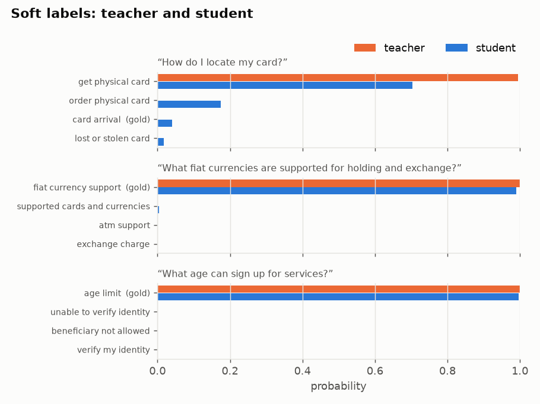
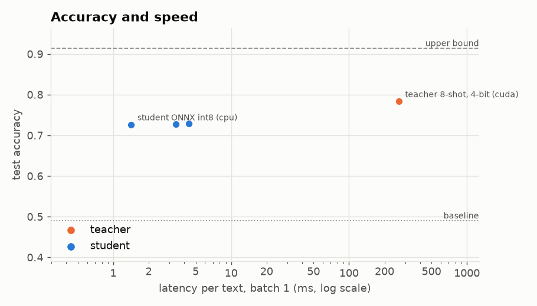

# Results and charts

## The results table

`tinydistill eval RUN` writes `RUN/results.md` and `RUN/results.json` with a row for the teacher and every form
of the student (PyTorch, ONNX, int8), plus the baseline and upper bound when trained:

- **Quality:** accuracy and macro-F1 on the gold-labelled test texts, and agreement with the teacher. Tasks
  with more than five labels also get top-3 accuracy; multi-label tasks micro-F1 and exact-match accuracy;
  ordered labels the mean distance in label steps.
- **Speed and size:** latency at batch 1 and 32, throughput, and size; the teacher is timed on each device in
  `--teacher-devices`.
- **Cascade:** accuracy and mean latency when the student passes its least confident texts to the teacher (see
  [Deploying](deploying.md#cascade)).

`tinydistill compare RUN1 RUN2 ...` puts runs in one table, and `tinydistill report RUN` rebuilds the Markdown
from the JSON.

## Charts

`tinydistill plot RUN` (with the `plot` extra) writes the charts of a run to `RUN/plots/`. In Python each chart is
a function in `tinydistill.plots` that returns a matplotlib figure.

| Chart | What it shows |
|---|---|
| `soft_labels` | for a few test texts, the teacher's probabilities (the soft labels) next to the student's |
| `speed_accuracy` | accuracy against latency for the teacher and every form of the student, with the baseline and upper bound |
| `training` | the loss per epoch on the training texts and, with `--val-share`, on the held-out texts and the kept epoch |
| `per_label` | F1 of every label for teacher and student, the teacher's weakest first |
| `confusions` | the confusion matrix over the labels involved in the most mistakes |
| `cascade` | accuracy as the student passes more of its least confident texts to the teacher |

{ width="49%" }
{ width="49%" }

## Error analysis

`tinydistill analyse RUN` writes `RUN/analysis.html`: precision, recall and F1 of every label for the teacher
and the student, the most common confusions with example texts, and texts where the two disagree. A label the
teacher gets wrong often usually needs a clearer name, a description, or merging with the label it is confused
with.
