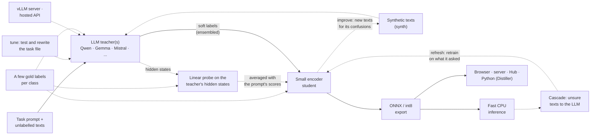

# tinydistill

**Most of a large model's quality on one task, many times faster, on a CPU.**

tinydistill turns an LLM classification prompt into a small classifier by knowledge distillation. You describe
the task in a short YAML file and give it unlabelled texts. An instruction-tuned LLM (the *teacher*) gives every
text a probability for every label, a small encoder (the *student*) learns to reproduce those soft labels, and the
student is exported to ONNX for fast inference on a CPU, in a browser or behind an HTTP server.

[Get started](getting-started/installation.md){ .md-button .md-button--primary }
[Try the live demo](https://andreas-hum.github.io/tinydistill/demo/){ .md-button }
[Distillation playground](https://andreas-hum.github.io/distillation-playground/){ .md-button }

## In one minute

```sh
pip install "tinydistill[hf]"
curl -LO https://raw.githubusercontent.com/Andreas-Hum/tinydistill/main/examples/financial-tweets/task.yaml
tinydistill run task.yaml --data hf:zeroshot/twitter-financial-news-sentiment:train --limit 2000 \
  --test hf:zeroshot/twitter-financial-news-sentiment:validation --int8 --out run
tinydistill predict run/onnx "Shares jump after the company beats earnings expectations"
```

`run` has the teacher label the texts, trains the student, exports it and writes a results table comparing the
two. Or try a model that is already trained, from the Hugging Face Hub:

```python
from tinydistill import Predictor  # pip install tinydistill

clf = Predictor("hf:Shroomy/tinydistill-banking77-minilm")
clf.describe(["I still haven't received my new card", "My card got stolen"])
# [{'label': 'card_arrival', 'confidence': 0.4672}, {'label': 'lost_or_stolen_card', 'confidence': 0.9921}]
```

## What it does well

<div class="grid cards" markdown>

- **No labels needed.** Any instruction-tuned LLM on the Hub labels your texts by scoring every label in one
  forward pass: no text generation, no answer parsing. [How it works](how-it-works.md)
- **Small, fast students.** A 23 MB MiniLM or an 8 MB static-embedding model, more accurate than its 7B
  teacher on Banking77 and hundreds of times faster. [Benchmarks](results.md)
- **Any teacher.** Local models in full precision or 4 bit, ensembles, or a remote vLLM server.
  [Choosing the teacher](guide/teacher.md)
- **Many labels.** A shortlist of likely labels per text: on CLINC150 (151 labels), six times faster and more
  accurate than scoring them all. [Many labels](guide/many-labels.md)
- **Tools around the loop.** Check the task file before labelling, see where it goes wrong, pick texts to label,
  route unsure texts to the LLM. [Improving a run](guide/improving.md)
- **Deploy anywhere.** ONNX and int8, an HTTP server, a static web page that shows what happens inside the
  model, or the Hugging Face Hub. [Deploying](guide/deploying.md)

</div>

## How it fits together



Each step is one command: `tinydistill label` (teacher), `train` (student), `export` (ONNX and int8) and
`predict` (inference), or `run` for all of them. Dashed parts are optional.

## Is it for you?

Use it when an LLM prompt already classifies your texts well enough but is too slow, too expensive or too large
to run on every text. Do not use it when the LLM itself is not good at the task (the student inherits its
mistakes), or when you have enough gold labels to train a classifier directly. More in
[When to use it](when-to-use.md).
